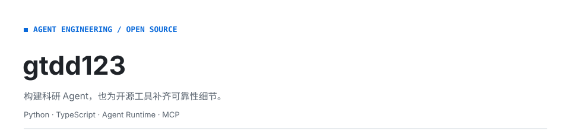
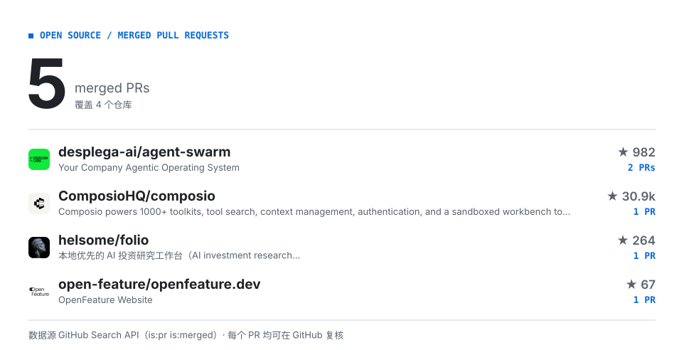

<picture>
  <source media="(prefers-color-scheme: dark)" srcset="./assets/hero-dark.svg">
  
</picture>

<!-- CONTRIB:BEGIN -->
<picture>
  <source media="(prefers-color-scheme: dark)" srcset="./assets/contrib-dark.svg">
  
</picture>
<!-- CONTRIB:END -->

## 代表作品

- **[BioEvidence](<https://github.com/gtdd123/bio-evidence>)**：面向医药科研的多端 Agent 工作区，聚焦文献检索、资料协作与可追溯引用。

## 更多信息

[BioEvidence 静态交互演示](<https://gtdd123.github.io/bio-evidence/>) · [查看已合并的公开 PR](<https://github.com/search?q=author%3Agtdd123+is%3Apr+is%3Amerged+is%3Apublic+-user%3Agtdd123&type=pullrequests>)
